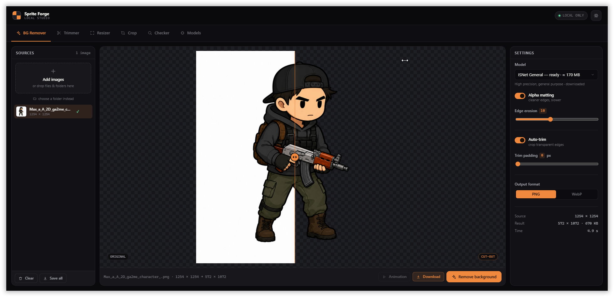

# Sprite Forge

<div align="center">




**A local, offline workbench for 2D game art.**

Turn raw images into clean, export-ready sprites — cut characters out of their backgrounds, trim wasted transparent borders, resize to exact target dimensions, slice atlases into individual icons, and inspect the alpha channel of everything you produce.

</div>

---

> ### 🔒 Local by design
> The server binds to `127.0.0.1` and rejects non-local requests. No accounts, no uploads, no cloud, no build step, no `npm install`. It is meant to be run on a desktop — never deployed as a public web service.

---

## 🎯 What is this?

**Sprite Forge** is a free, open-source image workbench built with plain Python and vanilla HTML/CSS/ES modules. It runs entirely on your machine: the interface is a single static web page, and the only server is a tiny Python process that wraps the optional AI background remover.

Six tools. One window. Zero cloud.

| Tool | Description | Where it runs |
|------|-------------|---------------|
| 🧠 **BG Remover** | AI cut-outs with 10 models, alpha matting, auto-trim, batch queue, before/after slider, animation preview and ZIP export | Browser + Python (`rembg`) |
| ✂️ **Trimmer** | Crops transparent or colour-matched borders with configurable padding, live preview | Browser only |
| 📐 **Resizer** | Seven resize modes, size presets, two resampling filters, PNG/JPEG/WebP export | Browser only |
| 🖼️ **Crop** | Draw boxes over an atlas to slice out individual icons, straight into a folder or a ZIP | Browser only |
| 🔍 **Checker** | Folder gallery with search, alpha breakdown, pixel picker, zoom and image comparison | Browser only |
| ⚙️ **Models** | Engine status, installed-model list, per-model download, reveal the model folder | Browser + Python |

Everything except **BG Remover** and **Models** works with plain Python 3.9+ and **no third-party packages at all**.

---

## 🖥️ The interface

```
┌─────────────────────────────────────────────────────────────┐
│ ◆ Sprite Forge            ● local only        ☾ / ☀         │  header
├─────────────────────────────────────────────────────────────┤
│  BG Remover │ Trimmer │ Resizer │ Crop │ Checker │ Models  │  tab bar
├─────────────────────────────────────────────────────────────┤
│  Settings / Sources          │        Stage / Preview       │
│  (queue, model, options)     │        (canvas, compare,     │
│                              │         metadata, export)    │
└─────────────────────────────────────────────────────────────┘
```

- **Header** — brand mark, a *local only* indicator, and a dark/light theme toggle (also `T`).
- **Tab bar** — the six tools above; each has its own panel and URL-independent state.
- **Work panels** — most tabs use a two-column layout: controls and a file queue on the left, a large preview/stage with metadata and export actions on the right.
- **Status and banners** — inline notices tell you when the AI engine is missing, a file is too large, or a model needs downloading.

The UI is plain HTML/CSS/ES modules, with a small set of shared helpers (`assets/lib/`) reused by every tab.

---

## 🚀 Quick Start

### Prerequisites

- **Python 3.9+** — [Download here](https://www.python.org/downloads/)
- That is the *only* requirement for the Trimmer, Resizer, Crop and Checker tabs.

### 1. Install dependencies (BG Remover only)

The server itself needs no third-party packages. To enable AI background removal, install the packages listed in `requirements.txt` with the same Python that runs the server:

```bat
py -m pip install -r requirements.txt
```

Skip this step if you only need the Trimmer, Resizer, Crop and Checker tabs.

### 2. Run the server

On Windows, double-click:

```bat
start.bat
```

Or run it yourself:

```bat
py server.py
```

Then open <http://127.0.0.1:8756/> — the browser opens automatically.

### 3. Useful flags

```bat
py server.py --port 8800     :: use another port if 8756 is busy
py server.py --no-browser    :: do not open a browser
```

The server prints its URL, project root and model folder on startup. Press `Ctrl+C` to stop it.

---

## 🧠 Optional: AI background removal

The **BG Remover** is powered by [rembg](https://github.com/danielgatis/rembg) by Daniel Gatis. It is the only feature that needs a third-party package — install it with the `requirements.txt` step in Quick Start, or directly:

```bat
py -m pip install -r requirements.txt
```

Restart the server afterwards. Nothing else to configure — model weights download automatically on first use into `%USERPROFILE%\.u2net`, shared with the desktop edition of the toolkit.

If `rembg` is missing, BG Remover shows a banner pointing at the Models tab and the other five tools keep working normally. That separation is deliberate: **all non-AI image work happens in the browser.**

### Available models

| Model | Notes |
|-------|-------|
| 🚀 `isnet-general-use` | High precision, general purpose |
| ⚡ `u2net` | Standard all-rounder |
| 💨 `u2netp` | Fast / lightweight — **best first test** (~5 MB) |
| 🎯 `u2net_human_seg` | Characters & human figures |
| 🎌 `isnet-anime` | Anime & cartoon art |
| 🖤 `silueta` | Silhouette-focused |
| 👕 `u2net_cloth_seg` | Clothing segmentation |
| 🧬 `birefnet-*` family | State-of-the-art family |

---

## 🛠️ Tool details

### 🧠 BG Remover

Add images by dropping files or a folder onto the queue. Pick a model, optionally enable alpha matting with an erode size, then process the batch. A draggable slider compares the original against the cut-out. Once two or more frames are processed, **Animation** plays them back in queue order with a speed slider and loop toggle. It plays the untrimmed cut-outs so every frame keeps its original canvas size and the character does not jitter. Export one image or the whole queue as a ZIP.

### ✂️ Trimmer

Removes empty borders so sprites take up only the space they need. Works in **alpha** mode (crop to non-transparent pixels) or **colour** mode (exclude pixels matching a colour). Colour mode *excludes matching pixels from the crop box* — it does not erase them, so the exported sprite stays pixel-identical to the source. This is a crop tool, not a recolour tool. Padding is adjustable and the result is previewed live.

### 📐 Resizer

Seven modes, all preserving aspect ratio:

- Fit (no upscale)
- Fit + upscale
- Exact canvas (pad transparent)
- Long edge
- Short edge
- Width only
- Height only

Presets cover common square sizes (128–2048) and 720p/1080p. Choose **Smooth** resampling for painted art or **Pixel art** for crisp nearest-neighbour scaling, and export as PNG, JPEG or WebP. *Exact canvas* always outputs the target size and never upscales the content — a 256×256 icon on a 512×512 canvas comes back centred with transparent padding.

### 🖼️ Crop

Load an atlas and drag boxes over the icons you want. In Chrome and Edge the tool writes each crop directly into a folder you pick once, named `<atlas>-001.png`, `<atlas>-002.png`, and so on. Press **Enter** to save the current box and clear it for the next icon, **Esc** to cancel. Without folder access, crops are collected in memory and the **ZIP** button downloads them all at once.

### 🔍 Checker

Load a folder (File System Access API in Chrome/Edge, folder input elsewhere) to browse every image with search, zoom and keyboard navigation. The alpha breakdown reports transparent, semi-transparent and opaque pixel percentages, and a pixel picker reads exact RGBA values. Alpha sampling is measured on a 128 px preview, so percentages are a close approximation rather than a full-resolution count.

### ⚙️ Models

Shows the Python version, whether `rembg` is installed, its version, the model folder path, and the install status and file size of every known model. Download weights individually, copy the folder path, or open the folder in Explorer.

---

## ⌨️ Keyboard shortcuts

| Key | Where | Action |
|-----|-------|--------|
| `T` | anywhere | Toggle dark / light theme |
| `←` `→` | Checker viewer | Previous / next image |
| `+` `-` `0` | Checker viewer | Zoom in / zoom out / fit |
| `I` | Checker viewer | Toggle the pixel picker |
| `/` | Checker gallery | Focus the search field |
| `Esc` | Checker viewer | Close the viewer |
| `Enter` | Crop | Save the current box |
| `Esc` | Crop | Cancel the current box |

---

## 🔧 How it works

```
.
├── index.html          application shell, icons and all six tab panels
├── assets/
│   ├── app.js          theme, tab switching and boot
│   ├── styles.css      design tokens for dark and light themes
│   ├── lib/            shared UI helpers, image pipeline, ZIP writer, queue, API client
│   └── tabs/           bg.js, trim.js, resize.js, crop.js, checker.js, models.js
├── docs/images/        README hero screenshot
├── requirements.txt    optional rembg dependency (BG Remover only)
├── server.py           static file server + rembg JSON API (standard library only)
└── start.bat           Windows double-click launcher
```

`server.py` uses only the Python standard library. It serves the static files and exposes four local endpoints:

| Endpoint | Purpose |
|----------|---------|
| `GET /api/status` | Engine version, Python version, model folder and model install status |
| `POST /api/remove?model=…&matting=…&erode=…` | Remove the background from an uploaded image |
| `POST /api/warmup?model=…` | Pre-load a model and download its weights |
| `POST /api/reveal` | Open the model folder in the file manager |

Requests are limited to local Host headers, uploads are capped at 64 MB, static paths are contained inside the project folder, and ONNX inference is serialised because `onnxruntime` sessions are not thread-safe. No CORS, no authentication and no upload quota are needed because nothing can reach the server from outside the machine.

---

## 🐛 Troubleshooting

**Port already in use** — `py server.py --port 8800`.

**"The background-removal engine is not available"** — `rembg` is not installed for the Python running the server. Check with `py -c "import rembg; print(rembg.__version__)"`.

**A model download seems stuck** — first use pulls 4–170 MB depending on the model; the Models tab shows the file size growing. Use `u2netp` to test quickly.

**WebP export produces PNG** — the browser could not encode WebP. The toolkit detects this and keeps a correct file extension.

**The Crop folder picker does nothing** — the File System Access API needs Chrome or Edge. Other browsers use the ZIP fallback.

---

## 🧰 Tech

- **Python 3.9+ standard library** (`http.server`, `threading`) — no server-side dependencies
- **`rembg` + ONNX Runtime** — optional, for background removal only
- **Vanilla HTML, CSS and ES modules** — no framework, no bundler
- **Canvas and the File System Access API** — client-side image processing

The background remover is powered by [rembg](https://github.com/danielgatis/rembg) by Daniel Gatis.

---

## 📄 License

[MIT](LICENSE) — free to use, modify and redistribute, with attribution.